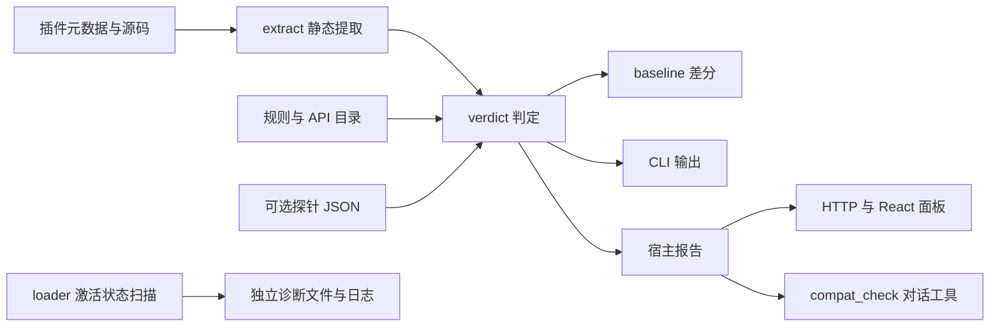

# GPT 审计及重构方案文档

审计日期：2026-10-14（Asia/Shanghai）  
审计对象：`lcy0121/dsh-plugin-compat-check` 当前工作目录  
代码基准：`4722716126614a4404eafa682e87a9742acbea9b`  
发布基准：npm `dsh-plugin-compat-check@0.1.0`  
执行边界：本次仅调查、审计、验证和提出方案；没有重构或修复实现，没有修改原有代码、测试、规则和信息文档，没有提交、push、发布或操作正式 DSH profile。

文中 `文件:行号` 均相对仓库根，指向上述代码基准。P1 表示应优先修复的产品问题，P2 表示下一阶段处理；它们与安全扫描的 medium 等级是不同口径。

## 1. 审计结论

项目具备值得保留的基础：共用 Node 判定内核、规则数据与判定逻辑分离、可追溯的调用位置、合成判据与快照并用、独立工具错误退出码，以及对官方目录不等于运行时面这一点的明确认识。现阶段适合渐进重构，不建议推倒重写。

**当前存在可复现 bug，且一部分直接破坏“结论可信”这个核心承诺。** 最重要的不是文件太长，而是证据模型把不同事情合并了：未采集与不存在、硬依赖与软读取、宿主与客户端、不同作用域的同名变量、同一行的不同调用，以及静态推断与真实激活状态。这些合并会同时制造误报和漏报。

实测结果：

| 检查 | 本次结果 | 能说明什么 |
|---|---|---|
| 默认测试套件 | 282 个测试项，281 通过、1 失败，约 6.78 秒 | 当前仓库并非全绿；不是 282 次独立功能实测，也不是精确的 assert 调用数 |
| 失败测试 | `test/docs.test.mjs:114`：README 写 172 个受控文件，Git 实际 174 | 文档与当前仓库漂移 |
| 合成内核反例 | 13 个提取/判定样例及 1 个基线差分样例 | 已复现本文列出的证据、归属、守卫和差分问题；不是生态准确率评估 |
| 宿主 mock | FAILED 与可用分叉、profile 参数失效、错误摘要失真 | 已复现真实代码路径的适配问题，未启动真实 DSH |
| Codex Security Standard | 3 项 medium，源码验证；覆盖标记为 partial | 风险有具体输入到敏感操作路径，但没有执行跨用户攻击 PoC，不能称为全文件穷尽安全认证 |
| npm 元数据与 tarball | latest=0.1.0；18 个文件；16 个逐字节相同，2 个不同 | 内核及宿主/客户端实现与本地相同，本文相关内核问题适用于线上 0.1.0 |

默认 suite 没有运行需要 `DSC_SLOW=1` 的探针启动、loader 标注和浏览器对账；其末尾即使显示 skipped=0，也不代表这些路径已测过。没有本机 profile 的若干测试会退出分支或跳过实际比对。因此“默认大部分通过”不能替代安装后验证或真实功能验证。

**建议：先安排一个有界的正确性与安全修补阶段，再引入轻量 AST 和显式报告契约，最后拆分适配层。** 单纯把 1600 行切成多个文件，会把现有错误分散到更多地方。

## 2. 本次调查范围与限制

已调查主链路：`lib/`、CLI、shell 编排、plugin 宿主和客户端、probe、发布脚本、规则/目录来源、测试设计、文档守卫、客户端诊断工具，以及 README 三语版、Plan.md、提取缺陷记录、skill、npm README。安全流程包含独立基线审阅、独立架构审阅与输入/文件系统专项审阅，最后由主审复核敏感消费者。

测试在临时仓库副本中执行，保留 Git 文件索引以验证受控文件计数；DSH 状态和 npm 缓存指向临时目录。普通 bug 的合成样例只创建临时假包和 mock 上下文，检查源码提取/报告行为，没有执行这些假包的插件代码。npm tarball 下载使用 `--ignore-scripts`，没有安装或运行发布插件。

限制必须与结论一起读：

- 没有重新启动正式/临时 DSH、安装第三方插件、驱动真实 Chrome 或运行慢集成测试。本次不能确认当前 DSH 上每个 UI 槽位和安装路径仍有效。
- 逐段深审覆盖核心产品实现和相关安全入口；部分辅助测试、夹具、翻译文档只做了结构、搜索和功能一致性检查。Codex Security 的 coverage 因此如实记为 partial。
- DSH 宿主的全局 HTTP 认证、监听/代理配置和工具调用授权不在此仓库内；相关远程安全故事没有充分证据。
- 安全审计针对当前源码，不扫描 Git 历史、不验证旧凭据有效性、不使用真实 token。
- Node 实测为 v26.11.1；没有验证声明最低版本 22.19.0、Node 24、Windows 或 Linux 集成路径。

## 3. 当前架构与实际能力



最后一条链路尤其重要：**loader 状态目前没有进入兼容性判定链。** “有运行时扫描代码”不能推出“面板的结论消费了扫描结果”。同样，进程内 plugin 的 `computeReport()` 默认仍读打包的目录，只有设置 `DSC_PROBE_REPORT` 才读取探针 JSON；它没有自动把当前上下文的服务面采集进判定。位置见 `plugin/index.js:927-949`。

| 入口 | 实际能力与副作用 |
|---|---|
| 静态 CLI | 读 `--nm`、规则/目录和可选探针；默认写基线；不执行被检查的插件代码 |
| `--probe-boot` | 复制 profile、安装 probe、启动 DSH 并执行该 profile 的插件；临时目录唯一；继承调用者环境 |
| shell | 查询 npm、使用固定 `plugincheck` profile 安装和启动、写固定 `/tmp` 文件、清理进程/profile |
| plugin | 静态检查选定 profile；HTTP/工具/面板；写基线以及额外 loader 诊断文件；默认没有实时服务面 |
| 客户端诊断工具 | `tools/client-arrival.mjs` 启动真实宿主和 Chrome，以 CDP 对账；属于开发工具，没有接入面板报告 |
| npm 包 | plugin、客户端、skill 和暂存内核；没有 CLI、shell 或 probe 入口 |

“同一份判定函数”应继续保留，但它只保证**相同输入下逻辑相同**。输入面、版本、profile、采样时间、缓存和基线写入时机不同，仍会产生不同结果。

## 4. 已确认的正确性问题

### B01 · P1：未采集的服务被升格为确定缺失

位置：`lib/verdict.mjs:259-269`、`:465-479`；探针输入处 `bin/compat-check.mjs:411-443`。

给一个声明 `inject=["missingSvc"]` 的假包，传入 `{root:{}}`。当前输出为 `broken / fatal / certain`。空 root 只能说明这个服务没有记录，不能说明它不存在。代码却用“整个 root 对象存在”作为服务缺失判定的运行时证据。

探针 JSON 没有 schema、采样完整性、profile、宿主版本或新鲜度校验；自动发现相邻 `probe-report.json` 还会优先于 `--probe-boot`。旧报告或缺项报告因此可以制造“确定”结论。

建议：每个服务记录 `present / absent / unobserved / unreadable`；只在该服务被成功采样且明确 absent 时判断缺失。报告绑定 profile 身份、版本、采样时间、wanted 集合与采样完成度；不符合时降级或拒绝使用，不能只看 JSON 能否解析。

### B02 · P1：硬依赖被一次软读取覆盖

位置：`lib/extract.mjs:1129-1144`，`lib/verdict.mjs:465-469`。

同一包同时有 `export const inject=["missingSvc"]` 和 `ctx.get("missingSvc", false)`，运行时明确 absent。当前只报 `partial / degraded`；它把服务加入 `softDeclaredServices` 后忽略硬声明。相反，普通 `ctx.svc.method()` 也被加入 `declaredServices`，可能被当成让 fiber pending 的硬依赖，而实际只是源码取用。

建议按**依赖记录/调用点**保留种类：顶层必须注入、可选注入、子 fiber 注入、普通读取、调用需求。软读取不能撤销顶层硬依赖；子 fiber 等待也不应直接推出整插件未激活。`impactBasis=measured` 应由这次真实状态支持，不能由某一类合成样例曾经测过来替代。

### B03 · P1：客户端一次提及可以掩盖宿主缺失

位置：`lib/verdict.mjs:322-342`。

假包宿主 `index.js` 声明并调用 `missingSvc`，客户端 `client.js` 也调用它，宿主报告明确 absent。当前整项被归到 `client-side`，最终 `ok`。`inAnyClientFile` 只要求任意客户端文件提到服务，并未排除真实宿主依赖。

建议按 `(插件, 执行端, 服务, 调用点/声明)` 判定；客户端无法观察可以留作 unknown，同时宿主硬依赖仍应独立报告。共用文件应允许拥有两个执行端标签，不能靠“先放进哪个桶”决定唯一身份。

### B04 · P1：守卫识别与去重会隐藏真实未守卫调用

位置：`lib/extract.mjs:926-1001`、`:1337-1352`，`lib/verdict.mjs:410-417`。

以下两例在方法缺失时均被判成 `ok / guarded`：

```js
ctx.settings.absent?.(); ctx.settings.absent();
if (typeof ctx.settings.absent === "function") console.log("yes");
ctx.settings.absent();
```

第一例的去重键只有服务、方法、文件、**行号**，同一行两个独立调用合成一个；守卫检测还查前 400/后 80 字符，另一个调用的可选链会污染本调用。第二例没有支配后续调用的控制流，附近出现能力检测却被当成安全网。辅助函数规则还只关联方法名与附近 if，没有证明检查的是同一接收者、正确分支或提前 return。

建议以 AST 节点 offset/span 标识调用；只合并同一个节点的多个识别来源。守卫必须属于当前调用或确实支配它的窄控制流；无法证明就标 `guardUnknown`。另外 `svc?.method()` 只检查服务是否为空，不保证非空服务存在 method；不能一概视为方法缺失兜底。

### B05 · P1：字符串、模板和作用域仍有已复现提取错误

位置：`lib/extract.mjs:538-589`、`:613-639`、`:1149-1157`、`:1192-1195`、`:1238-1243`。

| 输入形态 | 当前输出 | 问题 |
|---|---|---|
| 字符串 `"ctx.provide('missingSvc')"` + 真硬依赖 | provided 包含 missingSvc，判 ok | 文档/字符串示例被当作真实提供方 |
| 模板表达式中的 `ctx.settings.absent()` | calls={}，ok/vacuous | 把模板的 `${...}` 可执行部分整块抹掉 |
| 注释里的 `const svc=ctx.get("settings")`；实际 svc 是本地对象 | 本地 svc.absent 被归给 settings | 局部绑定解析仍用原文，注释污染绑定来源 |
| 两个函数各自 `const svc=ctx.get(...)`，分别是 settings/tools | 两处调用都归 settings，造出 settings.register | 按整个文件的变量名记首次绑定，没有词法作用域 |
| `ctx.settings?.absent()` | services/calls 都为空 | 可选服务形态未被主调用规则采集；不能以“零可检查对象”描述真实源码 |

这些不是要求实现全程序数据流分析。正确区分代码与字符串、遍历模板表达式、按作用域认绑定，是基础语法能力。Plan.md 用“跨函数追踪不划算”否决真解析器，混淆了基础解析与高成本语义分析。

### B06 · P1：副作用导入仍未扫描，却在历史中标为修复

位置：`lib/extract.mjs:148-152`；历史记录 `docs/extraction-findings.md:17`、`:67-70`。

假包入口 `import './worker.js'`，worker 内含真实服务调用。当前扫描文件只有 `index.js`、calls={}、ok/vacuous。导入正则只有 `from`、`require(...)`、`import(...)`，没有副作用 import。

建议将历史缺陷 #2 重新打开，补一个实际执行模块链的产品判据，然后由语法解析器提取 ImportDeclaration。历史 #19、#20、#22 等修复也应把保证收窄到已有夹具证明的具体形态。

### B07 · P2：JS 内置方法名过滤会吞掉最强来源的真调用

位置：`lib/verdict.mjs:419-424`。

`ctx.settings.set("x")` 明确来自宿主上下文，且运行时没有 set，仍因为 set 是内置集合方法名且目录没有它而被过滤，最终 ok。需要判断的是接收者身份；方法名常见并不能证明接收者是 Map。

建议只对低可信裸名或已证明为本地集合的接收者应用此过滤；最强 ctx-member 调用不能因黑名单消失。

### B08 · P1：真实未激活状态没有进入产品报告

位置：`plugin/index.js:475-576`、`:927-949`、`:1010-1023`；判定入口 `lib/verdict.mjs:194`。

本次 mock 的 loader 条目为 FAILED，`rescan()` 已输出 `stateHistogram={FAILED:1}`；随后同一插件 `compatReport()` 仍输出 `ok:1, broken:0, vacuousOk:1`。状态只写诊断文件和日志，buildVerdicts 不读取它；probe 的 entries 也没有成为判定输入。

建议建立 package ↔ loader entry 映射，并明确 group、disabled、启动未稳定、PENDING、FAILED 的语义。把当前实际状态作为单独证据送入报告，保留“静态 API 无发现”和“已激活/未激活”的区别。映射失败应暴露 unknown，不能猜包名。与 DSH 版本兼容无关的配置/自身异常也应保留具体类别，避免都叫版本不兼容。

### B09 · P2：声明核对格式过窄，疑似证据却生成确定“实测不符”

位置：`lib/verdict.mjs:494-509`、`:609-620`；`lib/extract.mjs:1520-1521`。

`declarationOf()` 只认 `compat[dshVersion] === 'compatible'`。Plan.md 提到的 `engines.dsh`、`dsh.compatibility.dshReleases` 和 peerDependencies 没有被该逻辑实际解释。具体官方字段语义仍需用目标 DSH 版本的真实规范/源码核对，不能直接猜 semver 契约。

更直接的已复现问题：没有运行时面，仅目录产生 suspected 的方法发现；假包用当前实现接受的版本声明格式标 compatible，新增的 declaration-mismatch 却是 certain，文案称“实测有失效”。

建议先实现并锁定正确的声明适配器；疑似发现最多生成疑似冲突。`certainty` 和 `impactBasis` 都应由本次证据推导，不因类别而硬编码升级。

### B10 · P2：对话工具忽略指定 profile，失败摘要像正常结果

位置：`plugin/index.js:747-764`、`:1177-1201`。

本次 mock 宿主 argv 指定 A，执行 `compat_check({profile:"B"})`，结果实际读取 A。工具只是临时设置 `process.env.DSC_PROFILE`，而 argv 优先级更高。该全局环境修改还在 await 期间影响其他计算，不是可靠的请求隔离。

另一个已复现分支：目录全部不存在时，text 说“体检没跑成”，summary 却是“可用 0 / 部分可用 0 / 不兼容 0”。

建议 compute 接收显式不可变 options；错误统一 `ok:false / status:tool-error / summary:无法判定`。找不到指定 profile 应失败，不能悄悄检查 desktop；面板与工具都要显示实际目标。

### B11 · P1：shell 固定 profile 和全局进程清理有破坏性

位置：`dsh-plugin-compat-check.sh:250-281`；与 Plan.md:381 的“不按模式杀进程”相矛盾。

所有运行共用 `plugincheck` 和固定 WORKDIR。并发运行会覆盖现场、交叉使用探针；如果用户本来就有同名 profile，脚本可能使用它并在退出时删掉。路径等式检查只验证固定字符串，不证明目录由本次创建。

`pkill -f "caffeinate -i"` 会杀掉不属于本次检查的防休眠进程；按固定 profile 模式 kill 也不能证明 PID 归属。上述是源码确认的危险行为，本次没有运行它来验证，以免影响用户环境。

建议每次唯一私有 profile/workdir，拒绝覆盖已有目录，记录创建与进程所有权，仅回收本次 PID/进程组。清理失败要返回具体残留。隔离 profile 仅隔离配置，**不是安全沙箱**；真实启动仍执行插件代码并继承用户环境。

### B12 · P1/P2：shell 的失败分类、JSON 和退出码不可靠

位置：`dsh-plugin-compat-check.sh:294-305`、`:326-334`、`:369-405`、`:406-426`。

- 任意安装失败（网络、权限、包不存在等）都报“不兼容”，然后 exit 0；没有先证明是版本闸门拒绝。
- `--json` 仅传给最终 Node CLI；前后阶段仍往 stdout 写标题/进度/收尾，因此整个输出不是可直接 JSON.parse 的一个 JSON 文档。
- 探针安装失败说“降级”，后续仍强制传不存在的 `--probe`，使 CLI 失败；随后警告不可靠，但脚本通常仍按最后成功 echo 退出 0。
- 只看日志中有无 `did not activate` 判断启动是否正常，早退出/没有到就绪状态也可能被描述为无告警。
- shell 固定目录未统一传 `DSC_OUT_DIR`；继承外部变量时 probe 可能写到别处，shell 等错路径。
- npm 规格 `name@version` 直接拼 registry 文档 URL，身份查询未先拆出包名；打印仓库地址也不等于已与用户期望仓库身份比对。

建议用 Node 编排复用参数/错误模型，stdout 始终只放最终 JSON，stderr 放进度；安装失败分 gate-rejected / install-error，启动需有 ready 证据，保留并传播工具错误退出码。提前静态检查也可以缩短执行第三方代码的路径，但不能把已有“隔离安装并启动”说成安装前无执行检查。

### B13 · P2：基线的身份、证据变化和写入时机不充分

位置：`lib/baseline.mjs:38-59`、`:117-167`；CLI `bin/compat-check.mjs:141-153`；plugin `plugin/index.js:815-846`、`:958-978`。

已复现：同一 finding 的 severity 从 degraded 变 feature-dead，certainty 从 suspected 变 certain，保持 key/category 与 verdict 档位不变，diff 仍报告无变化。版本变化但结论不变被装进 improved，会亮“变好”，实际应是中性升级。

基线没有记录工具/规则版本、采样模式与 profile 规范身份；不同非标准目录都可能用 `baseline.unknown.json`，不同 DSH_HOME 下同名 profile 也不是同一个对象。静态目录结果和真实探针结果共用文件，会把“测量方式变了”混成“插件变好/变坏”。写入是直接覆盖，跨 CLI/宿主进程无原子提交或锁。

缓存为空或 refresh 的计算没有使用同一个 computing 去重；每次 compute 都写基线，自动预热、工具和面板访问可能消费“变化”或互相覆盖；重算后变化角标消失也不等于用户已读。background refresh 返回 `ok:false` 时仍缓存失败对象。

建议拆出 ReportService、BaselineStore、ObservationIdentity，按 canonical profile 路径及证据模式建键；区分环境变化、规则变化、采样变化与插件变化。severity/certainty/位置变化单独记录，升级无结论变化记 neutral。原子写、跨进程并发策略和“何时推进比较基准/确认已读”须明确。

### B14 · P2：呈现丢失可信度与错误信息

位置：`lib/report.mjs:102-110`、`:142-151`；`plugin/index.js:1093-1098`；`plugin/lib/client.js:191-202`。

CLI 使用 impactBasis 标“推断，非实测”，而模型文本和面板只显示影响文案，没有保留这个限定。CLI 的 toJSON 也没带 baseline.writeError；同一结果在人类输出能看到写入失败，机器输出却不能。

`renderForModel()` 说“可用说明用到的 API 都在”，但 ok 的计算允许 filtered/client-side/abstained；这些并没有证明宿主 API 都在。`unknown` 虽存在于枚举和计数，最终档位基本仍是 ok/partial/broken，未知覆盖没有独立进入健康汇总。

建议共用展示 DTO 和文本片段，所有渠道保留依据、采样限制、impactBasis、写入/刷新错误、toolVersion。可用可改成“未发现兼容性问题”，另列证据覆盖；无数据、客户端未验证、解析失败不要再用绿色 ok 暗示已确认。

## 5. 安全问题与未确认事项

以下三项已由 Codex Security 收录，均为 **medium，源码置信度 high，未动态执行攻击**。没有确认 critical/high 或远程接管。

### S01：共享临时输出可能覆盖受害者可写文件

位置：shell `:250-281`、`:325`、`:369`；`probe/index.mjs:32-66`；`plugin/index.js:56-57`、`:128-136`。CWE-377 / CWE-59。

另一 OS 用户可先拥有共享 `/tmp/dsh-plugin-compat-check` 子目录并放入指向受害者文件的输出链接。probe 接受既有目录，普通写入跟随链接。shell 的删除/建目录失败未终止；不可由受害者清理的攻击者子目录可以保留，随后重定向以受害者权限写入。

明确限制：写入内容为固定日志/JSON，没有证明攻击者可任意选择完整内容或直接代码执行。CLI probe-boot 的私有 mkdtemp 路径不受该预置攻击影响；macOS 宿主默认私有 TMPDIR 也降低跨用户风险，但 shell/probe 的字面 `/tmp` 仍应修复。

修复验收：私有随机目录 + 初始化失败立即退出 + 一致传 DSC_OUT_DIR；持久输出校验所有权/权限并拒绝现有符号链接。只能在隔离测试目录构造负例，确认目录外 sentinel 不被覆盖。

### S02：可预测 CDP 端口泄漏临时 DSH token

位置：`tools/client-arrival.mjs:148-159`、`:205-226`。CWE-346。

诊断工具用 `9445+(pid%500)` 找 Chrome，忽略启动/绑定失败，信任端口返回的 `webSocketDebuggerUrl`，随后发送 `Page.navigate({url})`，其中 URL 含刚取得的 DSH token。抢占端口的另一用户可以冒充 CDP，获得临时宿主认证信息。

限制：本地攻击、临时宿主、正常 cleanup 缩短窗口；默认是 web 模板，选择 desktop 才涉及其克隆状态。不能据此声称既有 Chrome profile 或正式 desktop 已被接管。

建议使用 remote-debugging-pipe；或 port=0 从私有 Chrome 数据目录的 DevToolsActivePort 取得本次启动 endpoint，并验证子进程存活/地址归属。补占用端口负例与连接/命令超时。

### S03：目录符号链接放大静态扫描资源消耗

位置：`lib/extract.mjs:157-181`，尤其 `:173-177`；同步调用者 CLI `:405-408`、plugin `:941`。CWE-400 / CWE-674。

数据型静态检查会跟随目录链接，却没有 realpath/inode 去重或资源预算。带多个回链别名的本地包可造成组合式重复访问、重复文件路径和 CPU/堆消耗。此路径在执行插件代码之前已可达；进入宿主的同步计算还会阻塞事件循环。

限制：OS 链接深度/路径长度会终止个别分支，不能声称严格无限循环；npm 发布可能不保留符号链接，明确适用的是保留链接的本地/file 目录。已执行恶意插件本身具有用户权限，不能把其既有权限重复当成漏洞。

建议按真实目录身份去重，允许 pnpm 包根解析但控制包内链接外逃，增加文件/字节/深度/时间预算；超预算输出 partial，避免被当成已扫完。

### 尚不能升级成漏洞的事项

| 事项 | 已知事实 | 缺失证据/处理 |
|---|---|---|
| HTTP 的本机信任检查 | `plugin/index.js:1034-1044` 仅检查 Host/Origin，允许无 Origin；Host 是请求头，不是 socket 身份 | DSH 全局认证、bind、代理/CORS 未验证；不能直接写“远程认证绕过”。优先用宿主正式认证接口并核对移动/隧道场景 |
| 源码路径外逃 | localGraph 可读包根之外相对路径，文件链接也被跟随 | 没有任意原文件内容输出到攻击者的完整链；先作为路径/资源/证据范围缺陷处理 |
| 凭据 | 当前 probe 只写方法形状；当前搜索未找到可用硬编码凭据 | 文档记载过历史事故，本次没扫描历史或查轮换；“当前无发现”不能证明历史泄漏已消除 |
| probe getter/error | `typeof svc[key]` 可触发 getter，错误文本可能含敏感信息 | 已执行第三方服务通常已有同等权限；未发现具体密钥外传证据。改用 descriptor、对错误输出做必要脱敏 |
| runtime 隔离 | profile 与配置隔离，启动继承环境并执行插件 | 没有仓库自有 OS 沙箱；文档应准确说明执行权限。该授权运行本身不是新发现的任意代码执行漏洞 |
| XSS | 已审阅 UI sinks 使用 React 文本子节点 | 未发现 dangerouslySetInnerHTML 等可执行 HTML sink；保留该做法 |

## 6. Plan.md、README 与施工历史审计

### 6.1 Plan.md 可以保留，但“锁定/完成”状态需要重建证据

Plan.md 保存被否决方案、地雷与现场教训很有价值；问题在于历史决定与当前规范混在同一层，且测试并没有覆盖全部语义承诺。

| 文档问题 | 位置 | 应如何修正 |
|---|---|---|
| “真解析器必须完成”与“不做”同时存在 | Plan:104 对比 :262 | 用一项新的决策明确替代旧项；基础 AST 与跨函数追踪分开决策 |
| npm 同时交付 CLI 的承诺未兑现 | Plan:106；实际 package 无 bin | 明确 npm 仅 plugin、CLI 需仓库；或下一版真正补 CLI，不能用同版本号等同于同包交付 |
| 所有提取缺陷已修与记录冲突 | Plan:504 对比 extraction-findings #3 部分、#2 实测仍漏 | 逐项区分 resolved/partial/accepted limitation/reopened；为 closed 项关联回归样例 |
| 默认测试/文件计数过时 | Plan:501-503、:554；README:205 | 实际受控文件174，测试文件16，默认测试项282；Plan仍263/15；中文README重复 meta-check 行 |
| 数字守卫没有真正抓住 Plan 的写法 | docs.test:86-110，doc-check:55-60 | regex 抓“条断言/个测试文件”，Plan“263 条 / 15 个”不匹配；不要宣称所有数字被保护 |
| 额外文件写入未披露 | plugin README:69-71 对比 plugin:128-136 | 基线不是唯一写入；区分默认诊断、可选导出和状态保存，并提供关闭方式 |
| “只读、无副作用”过宽 | Plan:277-280、CLI:191-194 | 静态CLI默认写基线；用精确“无安装/无宿主启动/是否写状态”能力表 |
| “客户端独有能力”与实现位置混淆 | README:35、Plan:64/261 | 内置plugin只做入口可交付静态检查；真实浏览器到货对账是独立开发工具，尚未接入产品报告 |
| 严重度默认档文档不符 | rules README:44-51 对比 verdict:466-469 | 文档 ctx.get 缺失为 feature-dead，实现 degraded；明确真实回退证据，不能笼统认为软读取即有降级功能 |
| H3 自动测试的承诺过头 | Plan:307-311；packaging.test:46-66 | 测试实际打包、列tar文件并查清理，未解包运行 compute；历史手动验证与自动守门分开写 |
| 一份内核“绝不可能不一致”过强 | README:31；plugin:927-949；CLI:411-448 | 输入、运行时面、版本、缓存/基线时机会分叉；建立相同 observation 下入口一致性验收 |

还存在过期注释：extract 文件头仍描述跨插件全局污染与从 shell 抽 Python，而实际已有 perPlugin 与冻结参考实现；CLI 文件头称 plugin import run，而 plugin 实际自己适配；stage-kernel 注释称三个库却实际四个。此类残留会误导下一位施工者，宜在代码职责稳定后集中清理。

### 6.2 建议的信息文档结构

保留 Plan.md 作为项目入口，但每一项必须标明“当前规范、历史观察、提案、已替代”。将原施工事实按日期和提交落到简短 changelog/决策记录；历史观察保留版本、profile、样本范围和实测方式，不要求所有旧数字随新版本统一刷新。

当前状态应由一次可复算摘要生成，而不是维护三语 README 与 Plan 的十几处手写数字。测试统计叫“测试项”，不要叫 assert 总数。数字生成脚本不能在套件内递归调用自己，现有拆分思路可以保留。

`docs/extraction-findings.md` 继续作为缺陷台账，每项增加：当前状态、最小样例路径、验证命令、修复提交/版本、覆盖边界。允许 reopened，比把“37 条全修复”当永久承诺更可靠。

### 6.3 外部文档与发布核对

本次 `npm view` 核实 latest 为 0.1.0，版本列表含 `0.0.0-stage` 和 `0.1.0`。0.1.0 tarball shasum 为 `aedbcfbc3f346e2c2b3018dfa640e6a04fa1b23e`，与 Plan 简写一致。发布包的 extract/verdict/baseline/version、规则、宿主与客户端代码和本地一致；不同的是新增 keywords 与 npm README 中尚未发布的“推断，非实测”说明。这属于版本之间预期的文档漂移，不应伪装成线上已更新。

发布包没有 `bin/compat-check.mjs`、`report.mjs`、shell、probe 或独立 LICENSE 文件。CLI 缺失与根README“克隆后运行”的用法一致，却与 Plan 的单 npm 包承诺不符；LICENSE 建议随包携带，避免许可信息只有 metadata/短文案。

当前 GitHub 项目网页抓取失败，未据此核实远端分支、CI、简介或 tag；不能把本地提交状态等同于远端状态。awesome 列表已现场确认收录，但介绍仍偏“安装前、临时profile启动”那条 shell 路径，而不是当前主打的已装插件面板。建议后续提供准确描述更新，**本次没有发 PR 或修改外部页面**。

外部证据：[npm registry 包文档](https://registry.npmjs.org/dsh-plugin-compat-check)、[awesome 列表 Tools & Utilities](https://github.com/0xsline/awesome-deepseek-harness#tools--utilities)。npm 包文件清单和哈希由实际下载的 0.1.0 tarball 比对获得。

## 7. 重构方案评估

| 方案 | 优点 | 风险/不足 | 结论 |
|---|---|---|---|
| A：继续补正则，再拆大文件 | 依赖少、短期改动小 | 已有窗口、mask、作用域和调用去重错误会反复叠加；难以给 certain 证据 | 只用于紧急止血，不适合作为终态 |
| B：基础 AST + 显式证据契约 + 渐进适配层重构 | 一次解决语法/位置/作用域底座，保留判定与产品行为 | 引入解析依赖、支持JS/TS产物与容错策略需设计；快照会合理变化 | **推荐** |
| C：全程序跨函数/跨包语义分析或整体重写 | 理论上覆盖更多复杂形态 | 成本开放、仍不能证明第三方功能一定正常、迁移风险高 | 当前没有证据支持投入 |

### 7.1 建议的模块边界

下面是候选职责，不要求马上采用这些文件名，也不要求改成多仓库。

```text
core/
  package-inventory       包发现、metadata/exports/patch解释、输入诊断
  source-graph            入口可达与候选chunk、规范路径、资源预算
  syntax-analysis         AST、作用域绑定、调用span、声明/守卫证据
  observation             运行时面、loader状态、版本/profile/采样契约
  verdict                 纯判定、确定性/严重度/覆盖度
  baseline                纯差分，保留环境/证据/规则变化的不同原因
  presentation            渠道共用DTO、标签与推断限定
adapters/
  cli                     参数、输入加载、退出码
  dsh-host                service采样、entry映射、工具/HTTP
  browser                 只消费DTO；不重复判定
  baseline-store          原子持久化与并发策略
  probe-runner            明确授权的安装/启动与所有权清理
```

“纯内核”应限定为分析/判定/差分的纯函数，不把文件系统扫描叫纯计算。注入文件读取、clock、state store 等边界可帮助隔离测试；不必为每一个辅助函数建抽象类。

### 7.2 AST 的投入范围

需要：JS/MJS/CJS 常见产物、TS入口的明确支持策略；import/export/require 与模板表达式；字面量服务声明；scope-aware 的 ctx/get/别名/解构；调用节点 start/end/line/column；只在窄且可证明的控制流内认守卫。

暂不需要：任意动态拼接服务名、eval、全程序 interprocedural 分析、证明第三方业务功能完备。无法支持的语法/动态表达式必须返回结构化 diagnostic 和覆盖限制。解析失败不能悄悄退回正则后照样 certain；可以保留降级扫描，但证据等级必须有别。

解析库选择应通过一个有限比较实验决定：在合成反例、当前27个合成插件、锁定真实样本上，比较支持语法、错误恢复、耗时/内存和随包成本。不要在没有测量之前锁定某个库，也不要以“零依赖”作为压倒正确性的目标。无需 LLM 参与判定。

### 7.3 报告与运行时契约

建议报告包含：

- observationId：canonical profile 身份、DSH版本、采样来源/时间、插件版本或内容指纹、toolVersion、rules/catalog版本/哈希。
- 每端 service observation：present/absent/unobserved/unreadable，methods、是否完整/截断；不能只有一个布尔 hasRuntimeSurface。
- dependency/call evidence：执行端、声明种类、source span、binding来源、guard状态，provider声明与真实可用provider分开。
- loader observations：entryId、映射package、disabled/group、state、启动稳定度、失败原因和采集错误。
- summary：实际健康、兼容性发现、覆盖度/未知、工具状态分别表达；避免“没发现”自动升级为“全部确认可用”。

先引入向后兼容的新增字段和内部规范，再决定 schemaVersion 迁移；保持机器输出消费者可读。升级前留下几个代表性 JSON golden，而不是直接重建全部快照。

### 7.4 状态、并发与错误

将请求目标通过参数传递，禁止以修改 process.env 传递请求上下文。所有同目标计算走 single-flight；独立 profile/采样模式不要共享 promise。失败刷新保留最后有效报告并明确 stale/error；用户主动刷新可返回工具错误。

BaselineStore 负责原子写入和身份键；纯 diff 只处理数据。明确首次计算、后台预热、手动刷新、工具调用与已读确认谁推进基线。需要“变化留到用户看见”时，应把上一次观察和上一次确认状态分开。

异常边界保留现有“不拖垮宿主”目标，但不能 catch 后伪造正常 0 数量摘要。文件不可读、入口没解析、metadata坏、采样失败/截断都必须进入 diagnostics；受影响范围 partial/unknown，不能写出“完整基线”。

## 8. 建议实施阶段与验收

工期为估算的人日，不是承诺；未知 DSH 契约和安装路径可能拉长。所有阶段均是**后续提案，本次没有实施**。

| 阶段 | 内容 | 估算 | 放行条件 |
|---|---|---|---|
| R0 安全与执行边界 | S01/S02/S03，唯一profile与PID归属，shell错误/JSON | 2–4日 | 不写越界文件；占用CDP端口拒绝；链接扫描有上限；不杀旁人进程；工具失败不exit0 |
| R1 证据止血 | B01/B02/B03/B07/B09/B10/B14；报表先不作过度保证 | 2–4日 | 未采集不certain；软取不撤销硬依赖；宿主缺失不被客户端吞；profile实效与错误DTO正确 |
| R2 语法底座 | AST、scope、模板、side-effect import、调用span和窄守卫；迁移B04/B05/B06 | 4–7日 | 本文最小反例全部按人工判据通过；合法反例不新增误报；解析失败可见；性能预算不超标 |
| R3 宿主与状态适配 | B08/B13；RuntimeObservation、entry映射、缓存/原子基线、共享presentation | 3–5日 | FAILED/PENDING/disabled分清；相同observation三入口一致；刷新/并发不消费错误基线 |
| R4 交付与信息文档 | npm/CLI方案、LICENSE、包运行测试、CI矩阵、文档决策与历史重新标注 | 2–3日 | 离库tarball真正运行；最小Node矩阵；文档与产物一致；版本清单和测试摘要可复算 |

总估算约13–23人日，可分版本交付。安全止血和证据降级可以先于完整 AST 发出小版本；如果后续修改了实现，不应继续标同一个 0.1.0。

### 必须补的验收用例

1. 同一个服务，hard+soft、host+client、多个provider、未采集、明确absent、采样错误/截断、旧profile报告。
2. 同行多个调用、守卫仅影响一个调用、检测后无return、辅助函数检查另一个接收者、可选服务但缺方法。
3. 字符串/注释含伪声明、模板表达式真调用、正则字面量、跨函数同名变量、解构别名、side-effect import、共享代码双端标签。
4. loader FAILED但无API调用、PENDING子fiber、disabled/group、包/条目映射失败；这些不能靠快照自洽掩盖。
5. 指定A/B profile、profile不存在、输入目录无node_modules、坏package.json/不可读入口、仅有不支持语法；错误与0插件合法情形分开。
6. baseline同key severity/certainty变化、规则版本变化、静态与runtime切换、并发CLI/宿主、损坏文件、写失败、首次自动检查后面板可读差分。
7. CLI与plugin**相同 observation**报告一致；UI/模型/JSON均保留推断限定和工具版本/错误。
8. 打包到独立临时目录后真正import/apply/compute；不仅列文件。若交付CLI，离库运行其 --version/--help/--nm；若不交付，则所有文档明确这一点。
9. 安全负例只能在隔离临时资源里运行：目录外sentinel、预置输出链接、CDP占用端口、symlink别名资源上限，验证合法pnpm布局正常。

测试组织建议保留现有合成产品判据、快照与不变式三层，但将“读源码查注册函数名”类结构测试作为辅助。功能回归需实际调用行为。real profile 测试应显式显示需要什么fixture、为何跳过，长期增加可移植的锁定样本或下载后完整性验证步骤，而不是默认依赖作者 ~/.dsh。

CI建议至少Node 22.19/24与macOS/Linux离线unit+pack；Windows先测纯Node静态内核，boot/shell按支持范围另定。仓库当前没有发现CI工作流，不能声称发布前已跨平台验证。实际服务/浏览器契约必须另用明确DSH版本跑集成套件。

## 9. 发布与文档守门提案

`prepublish-check.mjs` 当前检查版本/private/默认套件，却没有调用 `tools/doc-check.mjs`，与“离线文档数字自检进发布闸门”的文案不一致。当前默认套件文件数测试本就失败，正常prepublishOnly将阻止发布；本次没有尝试发布。

下一阶段建议一个离线 release-check 入口输出结构化测试摘要并复用它校验文档，避免为了计数重复跑套件；随后验证已构建tarball的实际运行和必要文件。联网meta-check继续独立：取不到数据不等于全绿，尚未发布的README/keywords差异与真正错误分开，这个设计可保留。

GitHub分发、npm安装、直接 `file:<repo>/plugin` 三条路径分别列出验证证据。源码plugin依赖父目录内核，复制安装不一定运行prepack；因此不能拿仓库内apply成功推出复制包可用。GitHub仓库根没有package.json，是否DSH会选择plugin子目录需实测确认；在没有证据前不要继续写“两条都通”。npm包自足是已确认文件层事实，安装后激活与功能仍需独立测试。

建议把“安装插件后面板检查”“克隆仓库静态CLI”“显式安装并启动预检”作为三项独立交付能力。若选择增加npm CLI，stage需同时带bin、report、必要probe及正确路径解析；若保持npm仅plugin，直接删除Plan的未实现承诺即可，不必为了文档一致强行扩张范围。

## 10. 证据留档与本次改动

本次新增的项目文件仅本报告。基准状态最初干净；报告写入前再次检查仍无原文件改动。默认套件、合成样例和下载包在临时目录进行，原始结果已在本文以输入/实际输出/位置记录，不依赖临时文件长期保存。

普通反例汇总：

| 样例标识 | 实际输出 |
|---|---|
| unprobed-service | broken / fatal / certain（root为空） |
| hard-and-soft | partial / degraded（顶层硬依赖被软取降级） |
| optional-service | calls={} / ok / vacuous=true |
| guards-before-unsafe | ok / guarded（未守卫调用被隐藏） |
| nearby-unrelated-guard | ok / guarded（控制流不成立） |
| template-expression | calls={} / ok / vacuous=true |
| string-provider | provided=[missingSvc] / ok |
| comment-binding | settings.absent / partial（本地对象误归属） |
| scoped-alias | settings.known + settings.register，tools无调用 |
| side-effect-import | 仅index.js / calls={} / ok |
| js-builtin-real-method | settings.set被filtered / ok |
| client-hides-host | client-side / ok（宿主明确absent） |
| suspected-mismatch | 方法suspected，声明不符certain |
| baseline-evidence-change | comparable=true，全部变化列表为空 |
| loader-failed-disconnected | loader FAILED=1；compat ok=1 / broken=0 |
| tool-profile-ignored | wanted=B；实际nodeModules在profiles/A下 |
| tool-error-summary | summary为可用0/部分0/不兼容0；text说工具失败 |

Codex Security 扫描ID：`67adc733-02ab-46cb-a6f5-830aa4c807e2`，已完成生成与索引；覆盖仍标partial，未修复任何finding。工件位于：

`/Users/liuchenyu/.codex/state/plugins/codex-security/scans/dsh-plugin-compat-check/4722716126614a4404eafa682e87a9742acbea9b_20261014T133439Z_6xn1btru/`

可直接打开以下工件：

- [自动生成的安全报告](/Users/liuchenyu/.codex/state/plugins/codex-security/scans/dsh-plugin-compat-check/4722716126614a4404eafa682e87a9742acbea9b_20261014T133439Z_6xn1btru/report.md)
- [威胁模型](/Users/liuchenyu/.codex/state/plugins/codex-security/scans/dsh-plugin-compat-check/4722716126614a4404eafa682e87a9742acbea9b_20261014T133439Z_6xn1btru/threatmodel.md)
- [扫描清单](/Users/liuchenyu/.codex/state/plugins/codex-security/scans/dsh-plugin-compat-check/4722716126614a4404eafa682e87a9742acbea9b_20261014T133439Z_6xn1btru/scan-manifest.json)
- [结构化发现](/Users/liuchenyu/.codex/state/plugins/codex-security/scans/dsh-plugin-compat-check/4722716126614a4404eafa682e87a9742acbea9b_20261014T133439Z_6xn1btru/findings.json)
- [覆盖范围与未验证事项](/Users/liuchenyu/.codex/state/plugins/codex-security/scans/dsh-plugin-compat-check/4722716126614a4404eafa682e87a9742acbea9b_20261014T133439Z_6xn1btru/coverage.json)

本文件是用户要求的综合审计与重构方案，不替代这些安全工件。

扫描插件返回token统计为 `totalTokens=11146427`，标记partial并有 `token_record_invalid` 警告；这是原始工具统计，**不宜作为本次真实消耗或计费依据**，可信完整用量不可得。账号Daybreak为not_granted，可能限制受保护输出的界面显示，不影响这份本地文档交付。

后续可优先选择R0/R1作为第一批任务；在开始实现前，将本报告反例转成明确判据，修订Plan相互矛盾的现行承诺，再按阶段验收。该建议不构成本次已经开始施工。
