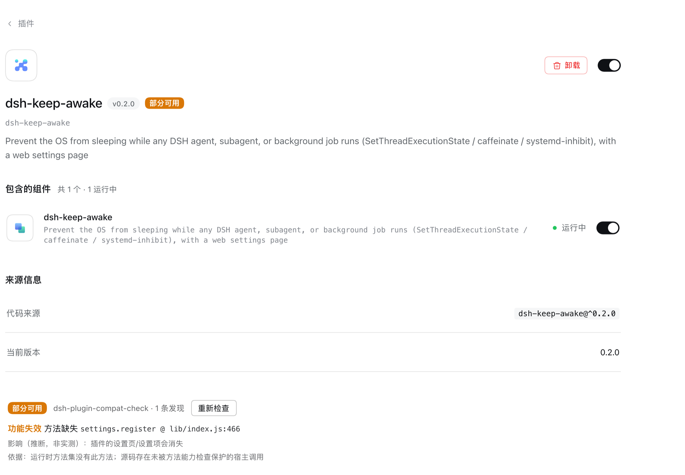
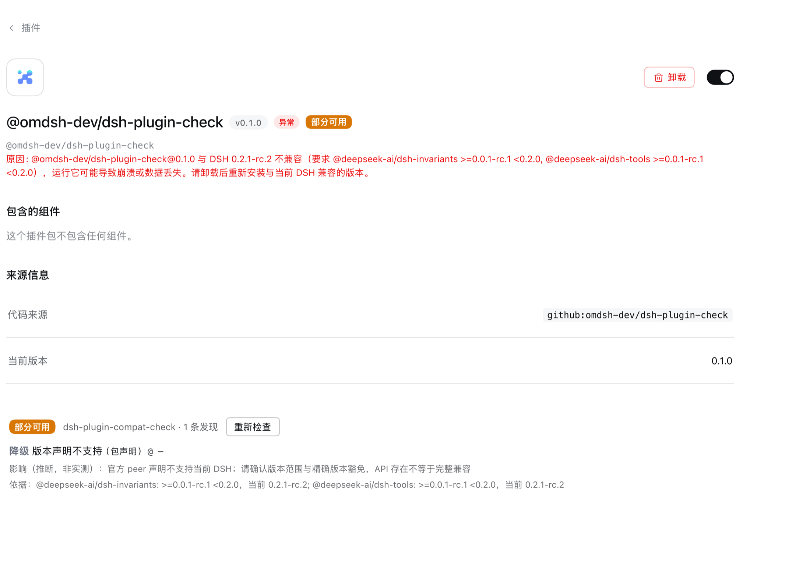

# dsh-plugin-compat-check

Checks **installed DSH plugins** against a target version, with source locations, evidence and coverage limits. Declaration acceptance, activation or no findings does not prove business functionality. [Star ⭐](https://github.com/lcy0121/dsh-plugin-compat-check) if useful.

[简体中文](README.md) | **English** | [한국어](README.ko.md)

## Versions and entry points

**0.1.7** includes rc.3 adaptation, upgrade preview, parameter semantics and boundary hardening. Node `^22.19.0 || >=24`; declared host minimum `>=0.2.0-rc.2`. Certified exact catalogues remain **0.2.0-rc.2, 0.2.1-rc.2 and 0.2.1-rc.3**; the minimum does not certify future hosts.

The npm plugin provides a compatibility page, details/badges, `compat_check` and a skill. Repository-only CLI, install checks, static batches, author CI and health executor share the kernel. The npm package has no CLI bin; `npx dsh-plugin-compat-check` is unsupported. [Plan](docs/Plan.md) tracks contracts and tasks; [docs/current-state.json](docs/current-state.json) records scoped verification.

## Screenshots

Historical examples of presentation, not acceptance of current source or business functionality:




## Install and use

```bash
dsh plugin --profile <profile> add dsh-plugin-compat-check
```

After installing, open the DSH instance using that profile, then navigate to:

**Bottom-left More (⋯) or user avatar (account menu) → Settings → Built-in plugins → Compatibility (兼容性)**.

“More” means the bottom-left account entry. Select the Compatibility tab inside Built-in plugins, and verify that this is the profile where you installed the plugin; do not assume desktop. Agents can also call `compat_check`.

### Using each panel

This describes the repository's **unpublished 0.1.8 development UI**. Layout and buttons in the published 0.1.7 may differ. The plugin currently displays Chinese labels; panel names below include them for reference.

| Panel | Purpose and actions |
|---|---|
| **Compatibility check / 兼容性检查** | Check verdict counts, the profile/target DSH, report time and cache status. Use Recheck to update the report; search and combine verdict/certainty/verification filters, then expand a row's findings/unverified items and coverage limits to read source locations, evidence and next steps. Main results show 50 rows per page with Previous/Next controls. |
| **Issue report / 故障报告** | Open Preview issue report, inspect sensitive information, then choose Copy report and share it yourself. Filters and pagination preserve the complete export; nothing is posted automatically. |
| **Static upgrade preview / 升级前兼容性预检（静态）** | Expand, enter an exact target DSH version, and choose Run upgrade preview. Read added/worsened risks, existing issues and coverage limits. This is static prediction: it does not install or upgrade DSH, and no new risks does not certify business functionality. |
| **Dependencies / 依赖关系与潜在影响** | Expand plugin/loader entries, service dependencies, candidate providers or impact paths as needed. Large tables show 50 rows per page. These are investigation clues; declarations, loader states and paths do not prove service availability or actual failure propagation. |
| **Manual review / 发现的人工处置** | Select a status for a finding you investigated, fill in Review evidence, and choose Save review. Track investigation progress, false-positive reasons or repair verification; see the steps below. |
| **Functional health / 功能健康检查（独立实测记录）** | Generate JSON with the repository health executor, then choose Import functional health record to inspect historical results and artifact identity. Skip this if you have no record. The panel only reads the file; it does not execute checks, install plugins or upload records. |
| **Report information / 报告说明与检查信息** | Read certainty, measured/inferred impact and coverage boundaries. Expand sampling/check information to inspect observations and target provenance. Catalogue/source details in the main results expose catalogue identity; uncertified targets display a warning directly. |

Auxiliary tables start collapsed; use the labelled Expand/Collapse buttons. Sections load as they approach the viewport, and wide tables scroll horizontally inside narrow containers. Plugin details/badges show individual results; the Compatibility tab contains the full list and filters.

New risks requires comparable history. A first or incomplete check may have no saved history; this does not mean there is no risk. An OK verdict with no verified calls does not certify business functionality either.

Finding lists, upgrade risk groups, both version inventories and input artifacts use 50-item pages. Added/worsened risks start expanded; other read-only details load on demand. Pagination preserves the complete export. The UI uses the host login session; if authentication fails, reopen the host-provided login URL. Never include that URL or cookies in a report.

### Saving a manual review

1. Expand a finding in the main results and investigate its source location and suggested next steps.
2. Choose **Investigate and review** (核实与人工处置) on an expanded finding to focus its editor. Filter by plugin (筛选处置插件) or manual status (筛选人工状态); each entry shows category, API, source location and a saved-evidence summary. **Return to main results** (返回主结果) clears main filters and opens the correct plugin/finding page. Links use report/finding identities, independent of sorting or pagination. Choose **Pending / Reviewed / False positive / Fixed**, then document the evidence: test steps and actual behavior for a false positive, or the change and retest result for a fix. Reviewed means a person investigated it, not that it passed.
3. Choose **Save review** (保存人工处置) and wait for the saved confirmation. Use Show more reviews (显示更多处置) for additional entries. Filters keep unsaved drafts visible and never hide risks in the main report. Expand prior-review summaries or the full review history when you need earlier evidence.

Unsaved input stays as a draft for the current page session. When a background refresh changes the report identity, the old draft is marked expired and cannot be saved onto a new finding. Choose Copy draft (复制草稿), investigate the current finding again and paste/save explicitly, or Discard draft (放弃草稿). Updates to records within the same report keep your input. Save or copy before reloading, leaving the page or unloading the plugin; drafts are not written to disk.

Records are stored locally. Changes to source, versions or evidence may require re-review, while old evidence remains in history. **Marking a finding false positive or fixed does not hide it, alter verdicts/exit codes/baselines or grant an exemption.** Recheck after changing code or configuration. You can skip manual review when you only need the current results.

See the [guide](docs/guide.md) for detailed operations, evidence boundaries and budgets.

## Repository CLI

Run repository tools from source:

```bash
git clone --branch main https://github.com/lcy0121/dsh-plugin-compat-check.git
cd dsh-plugin-compat-check
npm ci --ignore-scripts
node bin/compat-check.mjs --nm ~/.dsh/profiles/<profile> --no-baseline
node bin/compat-check.mjs --help
```

| Option | Purpose |
|---|---|
| `--nm <dir>` | Target profile or node_modules; required |
| `--dsh-version <v>` | Target DSH version; current version in preview mode |
| `--probe <json>` / `--probe-boot` | Read observations / explicitly launch a temporary host |
| `--json` / `--quiet` | Full JSON / summary line |
| `--no-baseline` / `--dry-run` | No baseline reads or writes / compare without writing |
| `--baseline-file <path>` | Custom baseline path |
| `--issue-report` | Shareable Markdown; review before sharing |
| `--rules <json>` / `--catalog <json>` | Override rules / reference catalogue |
| `--help` / `--version` | Full help / tool version |

Static checks do not execute targets or use the network. Ordinary checks write a baseline; no-baseline prevents reads/writes, and incomplete scans do not advance it. Probe-boot/install checks execute targets and require authorization. Private profiles are not OS sandboxes.

## Upgrade preview and author tools

Enter a target version in the panel or call `compat_check({"upgradeTo":"0.2.1-rc.3"})`. The agent uses the running host version and returns `upgradePreview`. CLI requires both exact versions:

```bash
node bin/compat-check.mjs --nm ~/.dsh/profiles/<profile> --dsh-version 0.2.1-rc.2 --upgrade-to 0.2.1-rc.3 --json
```

Compare any pair of the three exact versions; unknown versions exit 3. The same private bytes are compared statically, without host execution/upgrade, probes, exemptions or ordinary baselines. **0/1/2 mean no/nonfatal/fatal added or worsened risks; 3 means unavailable.** Zero may retain old risks. See the [contract](docs/Plan.md#27-升级前静态预检契约).

[Author CI](docs/author-ci.md) provides matrices, gates and JSON/SARIF/JUnit/HTML; the [guide](docs/guide.md#升级预检与有限批量) covers static batches. Health execution defaults to review; run requires authorization. See [skill](skill/README.md) and [complete tgz builds](plugin/README.md#从源码构建安装).

## Results and verification

Ordinary exits: **0 no conflicts found, 1 partial or unknown, 2 incompatible, 3 tool/input error**. Preserve certainty/impactBasis/coverage/vacuous; unobserved is not absent. Damaged baselines are preserved. Client business behavior needs separate acceptance. Review exports before sharing; nothing is posted automatically.

```bash
npm test
npm run check
node plugin/scripts/prepublish-check.mjs
node tools/meta-check.mjs --json
```

Default tests do not start real DSH/models; packaging regressions require the registry. `check` validates formatting, docs/generated copies, syntax and catalogues. Prepublish checks do not publish. Metadata checks need gh/npm and networking; unavailable sources are not passes. macOS/Linux evidence applies only to recorded scopes; Windows real-host acceptance is pending.

[Rules](rules/README.md) · [Maintenance and catalogue governance](docs/maintaining.md) · [Current evidence](docs/current-state.json).

## License

[MIT](LICENSE) · [Third-party dependencies and licences](THIRD_PARTY_NOTICES.md).
