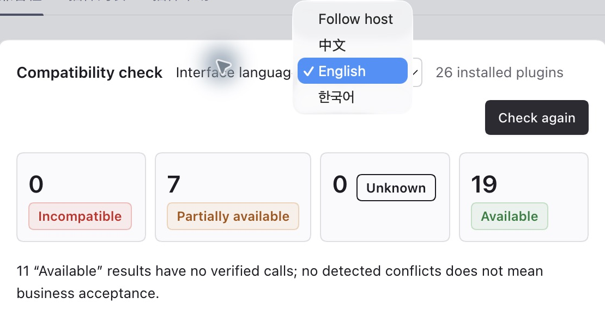

# dsh-plugin-compat-check

Checks **installed DSH plugins** against a target version, with source locations, evidence and coverage limits. Declaration acceptance, activation or no findings does not prove business functionality. [Star ⭐](https://github.com/lcy0121/dsh-plugin-compat-check)

[简体中文](README.md) | **English** | [한국어](README.ko.md)

## Versions and entry points

**0.2.2** provides exact DSH rc.5 catalogues, parameter/slot semantics, upgrade preview and author CI, plus a Chinese/English/Korean UI, dependency views, manual reviews and report history. Certified exact catalogues remain **0.2.0-rc.2, 0.2.1-rc.2, 0.2.1-rc.3 and 0.2.1-rc.5**. Node `^22.19.0 || >=24`; declared host minimum `>=0.2.0-rc.2` does not certify future hosts.

macOS/Linux rc.5 acceptance binds each exact commit and archive; [docs/current-state.json](docs/current-state.json) records its commit and scope. Later sources/packages require fresh verification. The npm plugin provides the page, details/badges, `compat_check` and skill. CLI, install checks, batches, author CI and health executor are repository tools. There is no npm CLI bin or `npx dsh-plugin-compat-check` support.

## Install and use

```sh
# Install this exact version
dsh plugin --profile <profile> add dsh-plugin-compat-check@0.2.2
# Verify the digest before using a local archive
dsh plugin --profile <profile> add file:/absolute/path/dsh-plugin-compat-check-0.2.2.tgz
```

In the DSH instance using that profile, open **bottom-left More (⋯)/avatar → Settings → Built-in plugins → Compatibility (兼容性)**. Do not assume desktop. Agents can call `compat_check`; source installations require a [complete tgz](plugin/README.md#从源码构建安装).

### Using each panel

The UI follows the host language; choose Chinese/English/Korean or restore Follow host. Unsupported languages fall back to English. Preferences stay local; switching preserves filters/drafts. Raw evidence, user notes, commands and JSON are not translated.

| Panel | Actions |
|---|---|
| Main results | Verify target, time/cache and catalogue; recheck, search/filter and expand findings. Preview diagnostic reports before copying; retain coverage and uncertified-target warnings. |
| Dependencies and potential impact | Expand dependencies, candidate providers and paths; declarations/loader states do not prove availability or failure propagation. |
| Manual review | Navigate from a finding, record status/evidence and explicitly save; return to the corresponding finding. |
| Static upgrade preview | Enter an exact target version; does not install or upgrade DSH. |
| Advanced tools | Load review archives, save/compare snapshots or import health JSON on demand; no automatic execution, collection or upload. |
| Footer information | Inspect tool version, sampling and target provenance. |

Auxiliary content starts collapsed. Results/dependencies/findings/upgrade details show 50 items per page; wide tables scroll in narrow containers. Filters/pages never trim full exports. Details/badges show one plugin. On 401, reopen the host login entry; never share login URLs/cookies.

### Manual review and history

1. Investigate the actual source location and next steps, select Unconfirmed/Reviewed/False positive/Fixed, document steps/results/evidence and save.
2. Recheck and re-review after source, target or evidence changes. Manual statuses never hide risks, change verdicts/exit codes/baselines or grant exemptions.
3. Drafts stay in the current page. Changed identities block stale saves; copy and investigate again or discard. Save/copy before reload or navigation.

Archival requires confirmation and a backup; restored/imported records are references. Explicitly save snapshots and select two to compare. Incompatible identities produce a neutral comparison; weaker evidence is not a repair. Export then delete when full, with no automatic pruning. The [guide](docs/guide.md) holds paths, limits and boundaries.

## Screenshots

Historical **0.2.0 / DSH 0.2.1-rc.3** captures from 2026-10-29, interface examples only, not acceptance evidence for the current artifact. Counts describe that check; upgrade/history images show forms without an executed comparison/save. Overview is English; workflow captures are Chinese.




## Repository CLI

```sh
git clone --branch main https://github.com/lcy0121/dsh-plugin-compat-check.git
cd dsh-plugin-compat-check
npm ci --ignore-scripts
node bin/compat-check.mjs --nm ~/.dsh/profiles/<profile> --no-baseline
```

| Option | Purpose |
|---|---|
| `--nm <dir>` | Profile or node_modules; required |
| `--dsh-version <v>` | Target DSH; current version in preview mode |
| `--probe <json>` / `--probe-boot` | Read observations / explicitly launch a temporary host |
| `--json` / `--quiet` | Full JSON / summary |
| `--no-baseline` / `--dry-run` | No baseline reads/writes / compare without writing |
| `--baseline-file <path>` | Custom baseline path |
| `--issue-report` | Markdown for preview and manual sharing |
| `--rules <json>` / `--catalog <json>` | Override rules / reference catalogue |
| `--help` / `--version` | Full help / tool version |

Ordinary static checks do not execute targets or use the network, but write their own baseline by default. Incomplete scans do not advance it; invalid originals remain intact. Probe-boot, install checks and health run execute targets and require authorization. Private profiles are not OS sandboxes.

## Upgrade preview and verification

Call `compat_check({"upgradeTo":"0.2.1-rc.5"})`; the current version comes from the host and results use `upgradePreview`. CLI requires both exact versions:

```sh
node bin/compat-check.mjs --nm <profile> --dsh-version 0.2.1-rc.3 --upgrade-to 0.2.1-rc.5 --json
npm test
npm run check
node plugin/scripts/prepublish-check.mjs
node tools/meta-check.mjs --json
```

Compare any pair of the four registered versions; unknown versions exit 3. Preview statically compares the same private bytes without probes, exemptions or ordinary baselines. Preview codes 0/1/2 mean no/nonfatal/fatal new or worsened risks; 3 means unable to preview. Zero may retain old risks. Ordinary codes are **0 no conflict found, 1 partially usable or unknown, 2 incompatible, 3 tool/input error**.

Default tests do not start real DSH/models; packaging tests need the registry. The prepublish gate does not publish, and unavailable metadata is not verification. Windows and general business functionality remain unverified. See [Plan](docs/Plan.md), [guide](docs/guide.md), [maintenance](docs/maintaining.md), [author CI](docs/author-ci.md), [rules](rules/README.md) and [skill](skill/README.md).

## License

[MIT](LICENSE) · [Third-party dependencies and licenses](THIRD_PARTY_NOTICES.md).
