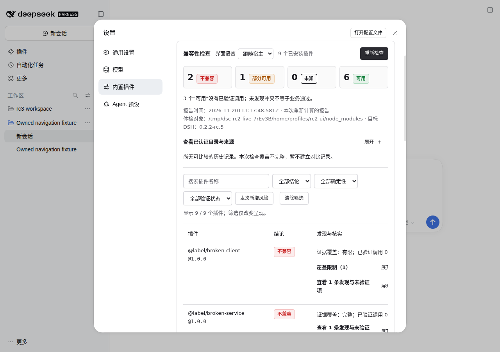

# dsh-plugin-compat-check

Checks **installed DSH plugins** against a target version, with source locations, evidence and coverage limits. Declaration acceptance, activation or no findings does not prove business functionality. [Star ⭐](https://github.com/lcy0121/dsh-plugin-compat-check)

[简体中文](README.md) | **English** | [한국어](README.ko.md)

## Versions and entry points

The current version is **0.2.6**. It ships an independently reviewed DSH 0.2.2-rc.5 catalogue, content refusal and search routing migration guidance, and an eight-version author CI matrix. The Chinese, English and Korean UI includes upgrade previews, dependencies, manual reviews and report history.

Certified exact catalogues remain **0.2.0-rc.2, 0.2.1-rc.2, 0.2.1-rc.3, 0.2.1-rc.5, 0.2.2-rc.1, 0.2.2-rc.2, 0.2.2-rc.3 and 0.2.2-rc.5**. Node `^22.19.0 || >=24`; declared host minimum `>=0.2.0-rc.2` does not certify future hosts.

The npm plugin provides the page, details/badges, `compat_check` and skill. The CLI, install checks, batches, author CI and health runner ship in the repository. The npm package has no CLI bin. See [acceptance and release receipts](docs/current-state.json) and the dated [upstream checks](docs/upstream-verification.md).

## Install and use

```sh
# Install 0.2.6 from npm
dsh plugin --profile <profile> add dsh-plugin-compat-check@0.2.6
# Or install a complete archive after verifying its digest
dsh plugin --profile <profile> add file:/absolute/path/dsh-plugin-compat-check-0.2.6.tgz
```

In the DSH instance using that profile, open **bottom-left More (⋯)/avatar → Settings → Built-in plugins → Compatibility (兼容性)**. Do not assume desktop. Agents can call `compat_check`; source installations require a [complete tgz](plugin/README.md#从源码构建安装).

### Using each panel

The UI follows the host language; choose Chinese/English/Korean or restore Follow host. Unsupported languages fall back to English. Preferences stay local; switching preserves filters/drafts. Raw evidence, user notes, commands and JSON are not translated.

| Panel | Actions |
|---|---|
| Main results | Verify target, time/cache and catalogue; recheck, search/filter and expand findings. Preview diagnostic reports before copying; retain coverage and uncertified-target warnings. |
| Dependencies and potential impact | Expand dependencies, candidate providers and paths; declarations/loader states do not prove availability or failure propagation. |
| Manual review | Navigate from a finding, record status/evidence and explicitly save; return to the corresponding finding. |
| Static upgrade preview | Enter an exact target version; does not install or upgrade DSH. |
| Advanced tools | Load review archives, save/compare snapshots or import health JSON on demand; no automatic execution, collection or upload. |
| Footer information | Inspect tool version, sampling and target provenance. |

Auxiliary content starts collapsed. Results/dependencies/findings/upgrade details show 50 items per page; wide tables scroll in narrow containers. Filters/pages never trim full exports. Details/badges show one plugin. On 401, reopen the host login entry; never share login URLs/cookies.

### Manual review and history

Check the source and next steps, then save Unconfirmed/Reviewed/False positive/Fixed with a note. Re-review when the source, target or evidence changes. Original findings, verdicts and baselines are retained. Save or copy drafts before reloading.

Back up before archiving. Save snapshots explicitly and select two to compare. See the [guide](docs/guide.md#人工处置归档与本地历史报告) for capacity and identity rules.

## Screenshots

0.2.6 on DSH 0.2.2-rc.5 in Chinese, captured on 2026-11-20 in an owned GitHub Actions Linux regression profile. Counts apply to its synthetic fixtures.



## Repository CLI

```sh
git clone --branch main https://github.com/lcy0121/dsh-plugin-compat-check.git
cd dsh-plugin-compat-check
npm ci --ignore-scripts
node bin/compat-check.mjs --nm ~/.dsh/profiles/<profile> --no-baseline
```

| Option | Purpose |
|---|---|
| `--nm <dir>` | Profile or node_modules; required |
| `--dsh-version <v>` | Target DSH; current version in preview mode |
| `--probe <json>` / `--probe-boot` | Read observations / explicitly launch a temporary host |
| `--json` / `--quiet` | Full JSON / summary |
| `--no-baseline` / `--dry-run` | No baseline reads/writes / compare without writing |
| `--baseline-file <path>` | Custom baseline path |
| `--issue-report` | Markdown for preview and manual sharing |
| `--rules <json>` / `--catalog <json>` | Override rules / reference catalogue |
| `--help` / `--version` | Full help / tool version |

Ordinary static checks do not execute targets or use the network, but write their own baseline by default. Incomplete scans do not advance it; invalid originals remain intact. Probe-boot, install checks and health run execute targets and require authorization. Private profiles are not OS sandboxes.

## Upgrade preview and verification

Call `compat_check({"upgradeTo":"0.2.2-rc.5"})`; the current version comes from the host and results use `upgradePreview`. CLI requires both exact versions:

```sh
node bin/compat-check.mjs --nm <profile> --dsh-version 0.2.2-rc.3 --upgrade-to 0.2.2-rc.5 --json
npm test
npm run check
node plugin/scripts/prepublish-check.mjs
node tools/meta-check.mjs --json
```

Compare any pair of the eight registered versions; unknown versions exit 3. Preview statically compares the same private bytes without probes, exemptions or ordinary baselines. Preview codes 0/1/2 mean no/nonfatal/fatal new or worsened risks; 3 means unable to preview. Zero may retain old risks. Ordinary codes are **0 no conflict found, 1 partially usable or unknown, 2 incompatible, 3 tool/input error**.

Default tests do not start real DSH/models; packaging tests need the registry. The prepublish gate runs local checks. Metadata lookup exits 3 if any requested source is unavailable and retains results from successful sources. Windows and general business functionality remain unverified. See [Plan](docs/Plan.md), [guide](docs/guide.md), [maintenance](docs/maintaining.md), [author CI](docs/author-ci.md), [rules](rules/README.md) and [skill](skill/README.md).

## License

[MIT](LICENSE) · [Third-party dependencies and licenses](THIRD_PARTY_NOTICES.md).
