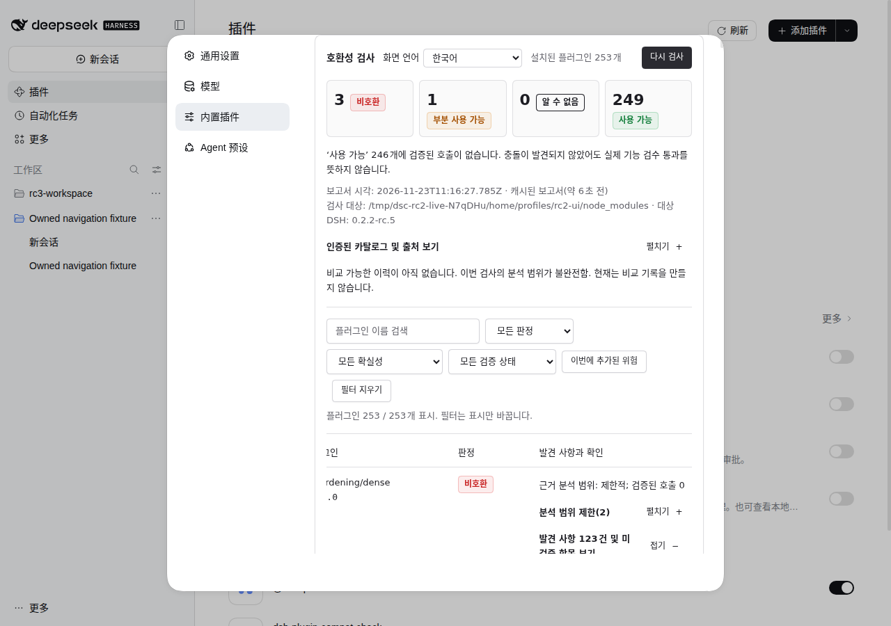

# dsh-plugin-compat-check

**설치된 DSH 플러그인**을 대상 버전과 비교하고 소스 위치, 근거, 분석 한계를 제공합니다. 버전 선언 통과, 활성화 또는 발견 없음이 실제 기능 성공을 보장하지 않습니다. [Star ⭐](https://github.com/lcy0121/dsh-plugin-compat-check)

[简体中文](README.md) | [English](README.en.md) | **한국어**

## 버전과 진입점

현재 버전은 **0.2.7**입니다. 호환성 검사는 2 MiB를 초과하는 소스 파일만 건너뛰고 나머지 파일과 플러그인을 계속 검사합니다. 해당 플러그인의 분석 한계를 펼치면 경로, 실제 바이트 수와 상한이 표시됩니다. 부분 보고서는 캐시할 수 있으며 기준선에는 마지막 전체 검사 결과가 유지됩니다.

인증된 정확한 카탈로그 버전은 **0.2.0-rc.2, 0.2.1-rc.2, 0.2.1-rc.3, 0.2.1-rc.5, 0.2.2-rc.1, 0.2.2-rc.2, 0.2.2-rc.3, 0.2.2-rc.5**입니다. Node `^22.19.0 || >=24`, 호스트 선언은 `>=0.2.0-rc.2`이며 미래 버전을 인증하지 않습니다.

npm 플러그인은 화면, 상세/배지, `compat_check`, skill을 제공합니다. CLI·설치 검사·배치·작성자 CI·기능 확인 실행기는 저장소에서 실행합니다. npm 패키지에는 CLI 실행 파일이 없습니다. [검수·배포 기록](docs/current-state.json)과 [상위 프로젝트 검증 기록](docs/upstream-verification.md)을 참고하세요.

## 설치와 사용

```sh
# npm에서 이 버전 설치
dsh plugin --profile <profile> add dsh-plugin-compat-check@0.2.7
# 또는 해시를 검증한 전체 아카이브로 설치
dsh plugin --profile <profile> add file:/absolute/path/dsh-plugin-compat-check-0.2.7.tgz
```

설치한 profile을 사용하는 DSH에서 **왼쪽 아래 더 보기(⋯)/아바타 → 설정 → 내장 플러그인 → 호환성(兼容性)**을 엽니다. desktop으로 가정하지 마세요. 에이전트는 `compat_check`를 호출할 수 있습니다. 소스 설치에는 [완전한 tgz](plugin/README.md#从源码构建安装)가 필요합니다.

### 화면별 사용법

화면은 호스트 언어를 따르며 중국어·영어·한국어를 지원합니다. 미지원 언어는 영어로 표시됩니다. 언어를 바꿔도 필터·초안·원본 근거는 유지되며 설정은 로컬에 저장됩니다.

| 화면 | 동작 |
|---|---|
| 주 결과 | 대상·시각/캐시·카탈로그를 확인하고 다시 검사하거나 검색/필터 후 발견을 펼칩니다. 진단 보고서는 복사 전 미리 보고 분석 한계와 미인증 경고를 유지합니다. |
| 의존 관계와 잠재 영향 | 서비스 의존성, 후보 제공자, 경로를 펼칩니다. 선언/loader 상태는 실제 제공이나 장애 전파의 증거가 아닙니다. |
| 수동 검토 | 발견에서 편집기로 이동해 상태/근거를 명시적으로 저장하고 해당 발견으로 돌아갑니다. |
| 정적 업그레이드 사전 검사 | 정확한 대상 버전을 입력합니다. DSH를 설치하거나 업그레이드하지 않습니다. |
| 고급 도구 | 필요할 때 검토 보관함, 보고서 저장/비교, 건강 JSON 가져오기를 실행합니다. 자동 실행·수집·업로드는 없습니다. |
| 하단 정보 | 도구 버전, 샘플링, 대상 출처를 확인합니다. |

보조 내용은 기본 접힘이며 결과/관계/발견/사전 검사 상세는 페이지당 50개입니다. 좁은 표는 가로 스크롤하고 필터/페이지는 전체 내보내기를 자르지 않습니다. 상세/배지는 단일 플러그인을 표시합니다. 401이면 호스트 로그인 진입점을 다시 열고 로그인 URL/Cookie를 공유하지 마세요.

### 수동 검토와 이력

검토 상태와 근거를 저장하세요. 소스·대상·근거가 바뀌면 재검토하고 새로고침 전에는 초안을 저장하거나 복사하세요. 수동 검토는 판정과 기준선을 유지합니다.

보관 전에 백업합니다. 스냅샷은 직접 저장하며 비교할 때는 두 개를 선택합니다. 한도와 식별 기준은 [가이드](docs/guide.md#人工处置归档与本地历史报告)를 참고하세요.

## 화면 예시

DSH 0.2.2-rc.5에서 본 0.2.7 한국어 패널입니다. 2026-11-23 Linux CI의 합성 테스트 데이터입니다.



## 저장소 CLI

```sh
git clone --branch main https://github.com/lcy0121/dsh-plugin-compat-check.git
cd dsh-plugin-compat-check
npm ci --ignore-scripts
node bin/compat-check.mjs --nm ~/.dsh/profiles/<profile> --no-baseline
```

| 옵션 | 용도 |
|---|---|
| `--nm <dir>` | profile 또는 node_modules, 필수 |
| `--dsh-version <v>` | 대상 DSH, 사전 검사에서는 현재 버전 |
| `--probe <json>` / `--probe-boot` | 관측 읽기 / 승인된 임시 호스트 시작 |
| `--json` / `--quiet` | 전체 JSON / 요약 |
| `--no-baseline` / `--dry-run` | 기준선 읽기·쓰기 금지 / 쓰지 않고 비교 |
| `--baseline-file <path>` | 사용자 기준선 경로 |
| `--issue-report` | 미리 보고 직접 공유할 Markdown |
| `--rules <json>` / `--catalog <json>` | 규칙 / 참고 카탈로그 재정의 |
| `--help` / `--version` | 전체 도움말 / 도구 버전 |

일반 정적 검사는 대상을 실행하거나 네트워크를 사용하지 않지만 기본적으로 자체 기준선을 씁니다. 불완전한 검사는 기준선을 갱신하지 않고 손상된 원본은 보존합니다. probe-boot·설치 검사·건강 run은 대상을 실행하므로 승인이 필요합니다. 비공개 profile은 OS 샌드박스가 아닙니다.

## 업그레이드 사전 검사와 검증

`compat_check({"upgradeTo":"0.2.2-rc.5"})`는 호스트의 현재 버전을 사용하고 `upgradePreview`를 반환합니다. CLI에는 두 정확한 버전을 지정합니다.

```sh
node bin/compat-check.mjs --nm <profile> --dsh-version 0.2.2-rc.3 --upgrade-to 0.2.2-rc.5 --json
```

등록된 여덟 버전의 임의 쌍을 비교하며 미등록 버전은 코드 3입니다. 같은 비공개 바이트만 정적으로 비교하고 probe·예외·일반 기준선을 사용하지 않습니다. 사전 검사 0/1/2는 새로 생기거나 악화된 위험 없음/비치명/치명, 3은 검사 불가이며 0에도 기존 위험이 남을 수 있습니다. 일반 종료 코드는 **0 충돌 미발견, 1 일부 사용 가능 또는 알 수 없음, 2 비호환, 3 도구/입력 오류**입니다.

Windows 실기와 실제 업무 기능은 별도 검증 대상입니다. [Plan](docs/Plan.md), [가이드](docs/guide.md), [유지보수](docs/maintaining.md), [작성자 CI](docs/author-ci.md), [규칙](rules/README.md), [skill](skill/README.md)을 참고하세요.

## License

[MIT](LICENSE) · [제3자 의존성과 라이선스](THIRD_PARTY_NOTICES.md).
