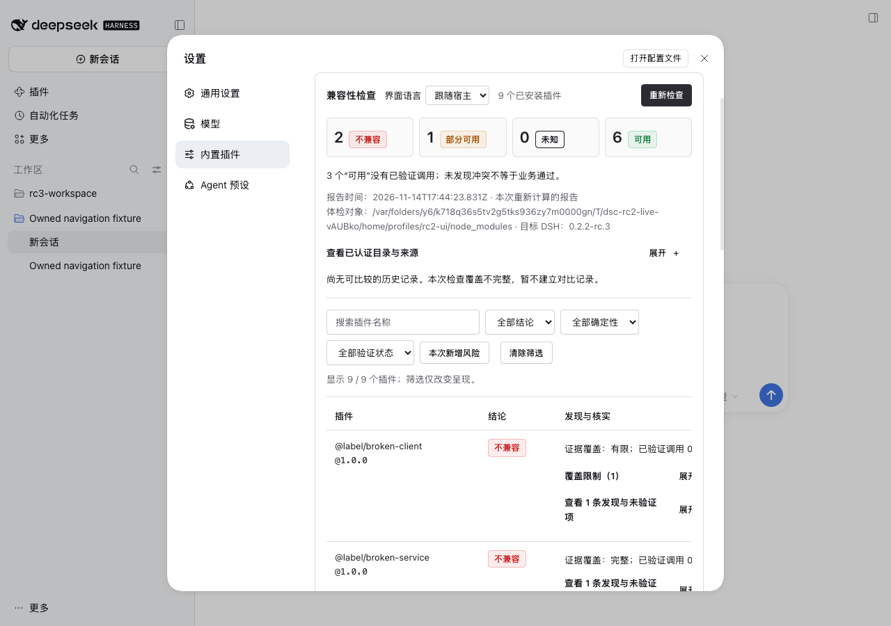

# dsh-plugin-compat-check

检查**已安装的DSH插件**与目标版本的兼容性，提供源码位置、依据和覆盖限制。声明放行、激活或无发现不等于业务正常。[Star ⭐](https://github.com/lcy0121/dsh-plugin-compat-check)

**简体中文** | [English](README.en.md) | [한국어](README.ko.md)

## 版本与入口

本源码为**0.2.6**候选，npm 与 GitHub 当前公开版均为 0.2.5。本版加入DSH 0.2.2-rc.5独立目录、拒答与搜索路由迁移提示及八版作者 CI，延续插件管理、鉴权与三槽位集成；支持中英韩界面、升级预检、依赖视图、人工处置和报告历史。已认证精确目录仅 **0.2.0-rc.2、0.2.1-rc.2、0.2.1-rc.3、0.2.1-rc.5、0.2.2-rc.1、0.2.2-rc.2、0.2.2-rc.3、0.2.2-rc.5**。Node `^22.19.0 || >=24`，宿主声明 `>=0.2.0-rc.2`；最低版本不认证未来宿主。

验收按提交、归档及平台记录于[docs/current-state.json](docs/current-state.json)。候选提交已通过全部 12 项检查。同一 CI 归档已通过 macOS 和 GitHub Actions Linux 的宿主验收。新归档按摘要重新验收。npm插件交付面板、详情/角标、`compat_check`和skill；CLI、安装检查、批量、作者CI及健康执行器只随仓库提供。npm无CLI bin，不支持`npx dsh-plugin-compat-check`。

市场/发行入口的带日期核验见[上游记录](docs/upstream-verification.md)。安装使用下方npm或完整tgz。

## 安装与使用

```sh
# 从 npm 安装当前公开版
dsh plugin --profile <profile> add dsh-plugin-compat-check
# 测试 0.2.6 候选时使用已构建的本地归档并核对摘要
dsh plugin --profile <profile> add file:/绝对路径/dsh-plugin-compat-check-0.2.6.tgz
```

在安装所用profile的DSH中打开：**左下角“更多”（⋯）/用户头像 → 设置 → 内置插件 → 兼容性**。不默认是desktop；agent可调用`compat_check`。源码安装须[构建完整tgz](plugin/README.md#从源码构建安装)。

### 界面各板块怎么用

界面语言默认跟随宿主，可切换中文/English/한국어；未知语言回退英文，偏好仅存本机。切换保留筛选与草稿，原始证据、人工依据、命令及JSON不翻译。

| 板块 | 操作 |
|---|---|
| 主结果 | 核对目标、时间/缓存及目录，重新检查、搜索/筛选并展开发现。故障报告先预览再复制，保留覆盖限制和未认证提示。 |
| 依赖关系与潜在影响 | 展开服务依赖、候选提供者和路径；声明/loader状态不证明实际提供或故障传播。 |
| 发现的人工处置 | 从发现定位编辑区，填写状态和依据并显式保存；可返回对应发现。 |
| 升级前兼容性预检（静态） | 输入精确目标版本运行比较，不安装或升级宿主。 |
| 高级工具 | 按需加载处置归档、保存/对照历史报告或导入健康JSON；不自动执行、采集或上传。 |
| 页尾检查信息 | 查看工具版本、采样与对象来源。 |

辅助区默认收起，明细每页50项、窄表横滚，筛选不裁完整导出；详情/角标只显示单插件。401时重开宿主登录入口，不分享登录URL/Cookie。

### 人工处置与历史记录

核实源码及“下一步”，填写待确认/已复核/误报/已修复和依据后显式保存。源码、目标或证据变化须重审；人工状态不隐藏风险、不改判定/基线或授予豁免。草稿仅驻当前页，过期禁保存；重载前保存或复制。

归档先确认并备份，恢复/导入只供参考。快照显式保存并选择两份比较，身份不相容中性显示、证据变弱不称修复；满额先导出再删除，无自动轮转。[指南](docs/guide.md)列路径、容量和边界。

## 界面示例

公开版 0.2.5 的界面（DSH 0.2.2-rc.3），2026-11-15自有macOS测试profile实拍（中文界面）。包含明确用于回归的合成插件，数字只代表该次检查，不是生态统计或全部业务通过；验收身份见[current-state](docs/current-state.json)。



## 仓库CLI

```sh
git clone --branch main https://github.com/lcy0121/dsh-plugin-compat-check.git
cd dsh-plugin-compat-check
npm ci --ignore-scripts
node bin/compat-check.mjs --nm ~/.dsh/profiles/<profile> --no-baseline
```

| 选项 | 作用 |
|---|---|
| `--nm <dir>` | profile或node_modules，必需 |
| `--dsh-version <v>` | 目标DSH；预检时为当前版本 |
| `--probe <json>` / `--probe-boot` | 读取观测 / 经授权启动临时宿主 |
| `--json` / `--quiet` | 完整JSON / 总结行 |
| `--no-baseline` / `--dry-run` | 禁读写基线 / 比较但不写 |
| `--baseline-file <path>` | 自定义基线路径 |
| `--issue-report` | 生成供预览分享的Markdown |
| `--rules <json>` / `--catalog <json>` | 覆盖规则 / 参考目录 |
| `--help` / `--version` | 完整帮助 / 工具版本 |

普通静态检查不执行目标或联网，默认写自身基线；不完整扫描不推进，坏原件保留。probe-boot、安装检查及健康run会执行目标，须相应授权；私有profile不是OS沙箱。

## 升级预检与验证

以下 rc.5 示例使用 0.2.6 候选代码。工具调用`compat_check({"upgradeTo":"0.2.2-rc.5"})`，当前版本取宿主，返回`upgradePreview`；CLI显式给两个精确版本：

```sh
node bin/compat-check.mjs --nm <profile> --dsh-version 0.2.2-rc.3 --upgrade-to 0.2.2-rc.5 --json
npm test
npm run check
node plugin/scripts/prepublish-check.mjs
node tools/meta-check.mjs --json
```

八个登记版本可任意比较；未知版本退出3。预检只静态比较同组私有字节，不借probe、豁免或普通基线。预检0/1/2为无/非致命/致命新增或变重风险，3为无法预检；0仍可有旧风险。普通退出码为**0未发现冲突、1部分可用或未知、2不兼容、3工具/输入错误**。

默认测试不启动真实DSH/模型，打包回归需要registry；发布前检查不发布，元数据核验只要有请求来源取数失败就退出 3，仍保留成功来源。Windows和一般业务未获认证。详见[Plan](docs/Plan.md)、[使用指南](docs/guide.md)、[维护流程](docs/maintaining.md)、[作者CI](docs/author-ci.md)、[规则](rules/README.md)与[skill](skill/README.md)。

## License

[MIT](LICENSE) · [第三方依赖与许可证](THIRD_PARTY_NOTICES.md)。
