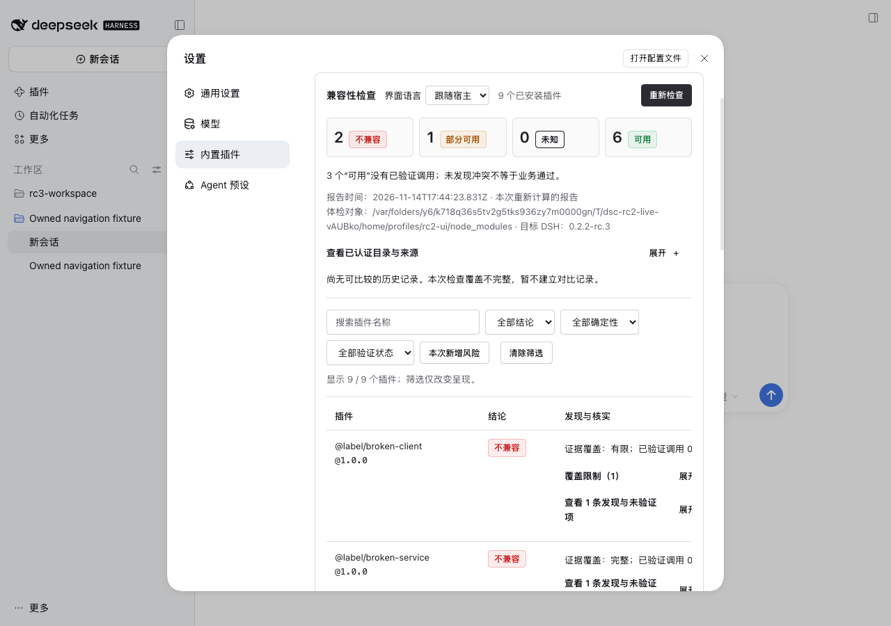

# dsh-plugin-compat-check

检查**已安装的DSH插件**与目标版本的兼容性，提供源码位置、依据和覆盖限制。声明放行、激活或无发现不等于业务正常。[Star ⭐](https://github.com/lcy0121/dsh-plugin-compat-check)

**简体中文** | [English](https://github.com/lcy0121/dsh-plugin-compat-check/blob/main/README.en.md) | [한국어](https://github.com/lcy0121/dsh-plugin-compat-check/blob/main/README.ko.md)

## 版本与入口

当前版本为**0.2.5**。本版已完成DSH 0.2.2-rc.2/rc.3独立目录、Agent/工具/Session迁移提示及新版插件管理、鉴权和三槽位适配；支持中英韩界面、升级预检、依赖视图、人工处置和报告历史。已认证精确目录仍仅**0.2.0-rc.2、0.2.1-rc.2、0.2.1-rc.3、0.2.1-rc.5、0.2.2-rc.1、0.2.2-rc.2、0.2.2-rc.3**。Node `^22.19.0 || >=24`，宿主声明 `>=0.2.0-rc.2`；最低版本不认证未来宿主。

验收按提交、归档及平台记录于[docs/current-state.json](https://github.com/lcy0121/dsh-plugin-compat-check/blob/main/docs/current-state.json)；新制品须重验。npm插件交付面板、详情/角标、`compat_check`和skill；CLI、安装检查、批量、作者CI及健康执行器只随仓库提供。npm无CLI bin，不支持`npx dsh-plugin-compat-check`。

市场/发行入口的带日期核验见[上游记录](https://github.com/lcy0121/dsh-plugin-compat-check/blob/main/docs/upstream-verification.md)。安装使用下方npm或完整tgz。

## 安装与使用

```sh
# 固定安装本版
dsh plugin --profile <profile> add dsh-plugin-compat-check@0.2.5
# 使用本地归档前核对摘要
dsh plugin --profile <profile> add file:/绝对路径/dsh-plugin-compat-check-0.2.5.tgz
```

在安装所用profile的DSH中打开：**左下角“更多”（⋯）/用户头像 → 设置 → 内置插件 → 兼容性**。不默认是desktop；agent可调用`compat_check`。源码安装须[构建完整tgz](#从源码构建安装)。

### 界面各板块怎么用

界面语言默认跟随宿主，可切换中文/English/한국어；未知语言回退英文，偏好仅存本机。切换保留筛选与草稿，原始证据、人工依据、命令及JSON不翻译。

| 板块 | 操作 |
|---|---|
| 主结果 | 核对目标、时间/缓存及目录，重新检查、搜索/筛选并展开发现。故障报告先预览再复制，保留覆盖限制和未认证提示。 |
| 依赖关系与潜在影响 | 展开服务依赖、候选提供者和路径；声明/loader状态不证明实际提供或故障传播。 |
| 发现的人工处置 | 从发现定位编辑区，填写状态和依据并显式保存；可返回对应发现。 |
| 升级前兼容性预检（静态） | 输入精确目标版本运行比较，不安装或升级宿主。 |
| 高级工具 | 按需加载处置归档、保存/对照历史报告或导入健康JSON；不自动执行、采集或上传。 |
| 页尾检查信息 | 查看工具版本、采样与对象来源。 |

辅助区默认收起，明细每页50项、窄表横滚，筛选不裁完整导出；详情/角标只显示单插件。401时重开宿主登录入口，不分享登录URL/Cookie。

### 人工处置与历史记录

核实源码及“下一步”，填写待确认/已复核/误报/已修复和依据后显式保存。源码、目标或证据变化须重审；人工状态不隐藏风险、不改判定/基线或授予豁免。草稿仅驻当前页，过期禁保存；重载前保存或复制。

归档先确认并备份，恢复/导入只供参考。快照显式保存并选择两份比较，身份不相容中性显示、证据变弱不称修复；满额先导出再删除，无自动轮转。[指南](https://github.com/lcy0121/dsh-plugin-compat-check/blob/main/docs/guide.md)列路径、容量和边界。

## 界面示例

0.2.5 / DSH 0.2.2-rc.3，2026-11-15自有macOS测试profile实拍（中文界面）。包含明确用于回归的合成插件，数字只代表该次检查，不是生态统计或全部业务通过；验收身份见[current-state](https://github.com/lcy0121/dsh-plugin-compat-check/blob/main/docs/current-state.json)。



## 从源码构建安装

根目录是private工作区；检出main或所需提交，在根安装依赖后打完整包：

```sh
npm ci --ignore-scripts
cd plugin
npm pack --pack-destination <已存在的绝对输出目录>
dsh plugin --profile <临时profile> add file:<生成的tgz绝对路径>
```

prepack同步skill、契约、客户端、内核及许可证；postpack清理暂存内核。根GitHub spec、裸plugin复制或源码file安装不能替代完整tgz；重新打包不继承旧归档验收。

## 升级与仓库工具

调用`compat_check({"upgradeTo":"0.2.2-rc.3"})`，当前版本取宿主，返回upgradePreview、report为null。七个登记精确版本可任意比较，未知版本/范围退出3。只做同组私有字节的静态比较，不安装或升级宿主，也不借用probe、豁免或普通基线；预检0/1/2表示无/非致命/致命新增或变重风险，3为无法预检，0仍可有旧风险。

CLI、批量、作者CI及健康执行器从仓库运行，使用见[指南](https://github.com/lcy0121/dsh-plugin-compat-check/blob/main/docs/guide.md)与[作者CI](https://github.com/lcy0121/dsh-plugin-compat-check/blob/main/docs/author-ci.md)。契约/待办见[Plan](https://github.com/lcy0121/dsh-plugin-compat-check/blob/main/docs/Plan.md)，构建及目录治理见[维护流程](https://github.com/lcy0121/dsh-plugin-compat-check/blob/main/docs/maintaining.md)。certainty与impactBasis独立；未观测不等于缺失，coverage/vacuous必须保留。Windows与一般业务未获认证。

## License

[MIT](https://github.com/lcy0121/dsh-plugin-compat-check/blob/main/LICENSE) · [第三方依赖与许可证](https://github.com/lcy0121/dsh-plugin-compat-check/blob/main/THIRD_PARTY_NOTICES.md)，均随npm包提供。
